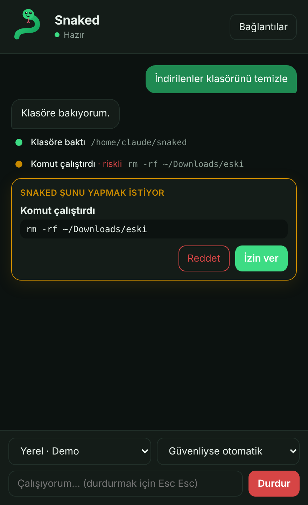

<p align="center"></p>

<h1 align="center">Snaked</h1>

<p align="center">
  Your Own Computer Snake: masaüstünde yaşayan, bilgisayarında senin yapabildiğin her şeyi yapan açık kaynaklı agent.<br>
  macOS, Windows ve Linux. ChatGPT veya Claude aboneliğin, API anahtarların ya da Ollama ile çalışır.
</p>

<p align="center"></p>

> Erken aşama (v0.1 iskeleti). Mimari ve yol haritası: [docs/mimari-ve-yol-haritasi.md](docs/mimari-ve-yol-haritasi.md)

## Neler var

- **Her modelle çalışır:** ChatGPT aboneliği (Codex CLI ile), Claude aboneliği (Claude Code ile), LiteLLM üzerinden OpenAI, Anthropic, Gemini, Mistral, Groq, DeepSeek, xAI, OpenRouter API anahtarları, Ollama ve LM Studio otomatik algılama.
- **Bilgisayarı kullanır:** komut çalıştırma, dosya okuma/yazma, ekran görüntüsü, fare ve klavye, uygulama açma. Önce doğrudan yolları (komut, dosya) dener, gerekirse ekrana geçer.
- **Güvenli:** dört izin modu (sadece öner, her adımda sor, güvenliyse otomatik, tam otomatik). Silme, ödeme, şifre ve mesaj gönderme gibi riskli işlemler her modda onay ister. Şifre yöneticileri engelli. Durdur butonu ve iki kez Esc her an çalışır.
- **Güzel:** ruh haline göre animasyonlu yılan maskotu, açık/koyu tema, adım adım zaman çizelgesi.

## Yapı

```
apps/desktop/   Tauri 2 + React arayüz; açılışta Python çekirdeğini başlatır
core/           Python agent çekirdeği (snaked-core)
  providers/    model sağlayıcıları (LiteLLM, abonelik CLI'ları, yerel)
  computer/     platformlar arası ekran/fare/klavye sürücüleri
  safety.py     izin modları ve risk sınıflandırma
  agent.py      agent döngüsü
  server.py     arayüzün bağlandığı yerel WebSocket sunucusu
docs/           mimari ve yol haritası
```

## Geliştirme

Gerekenler: [Node 20+](https://nodejs.org), [Rust](https://rustup.rs), [uv](https://docs.astral.sh/uv/) ve [Tauri ön koşulları](https://tauri.app/start/prerequisites/).

```bash
cd core && uv sync --extra desktop && cd ..
cd apps/desktop && npm install
npm run tauri dev
```

Sadece arayüz üzerinde çalışmak için: `cd core && uv run snaked-core serve --token dev`, ayrı terminalde `cd apps/desktop && npm run dev`, sonra http://localhost:1420.

Testler: `cd core && uv run pytest`.

## Lisans

[MIT](LICENSE)
